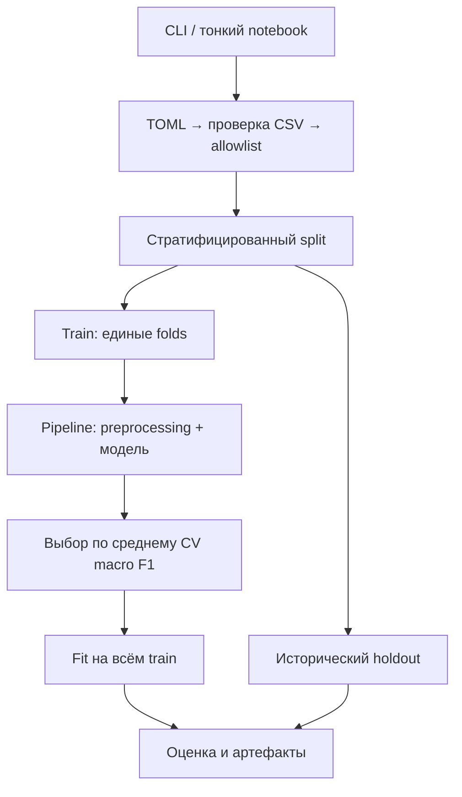
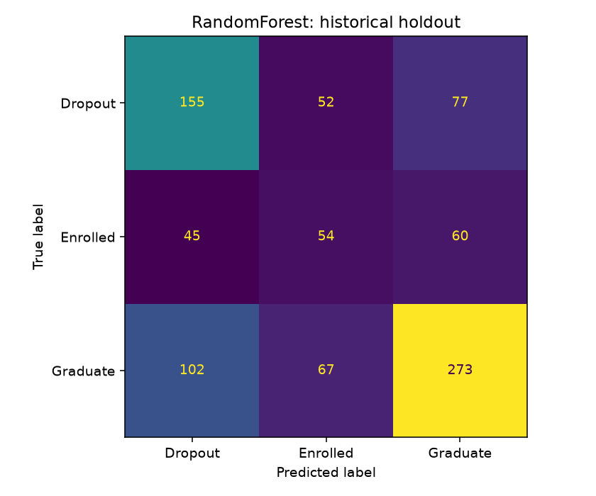

# student-outcome-classification


Воспроизводимое сравнение моделей исхода обучения по данным на момент поступления.

## Быстрый запуск

Нужен Python 3.12 и uv. В PowerShell перейдите в распакованную папку проекта:

```powershell
uv sync
uv run ruff check .
uv run ruff format --check .
uv run ty check
uv run pytest
New-Item -ItemType Directory -Force data/raw
# Скопируйте исходный data.csv в data/raw/data.csv
uv run student-outcome --config configs/default.toml
```

Если команда `uv` не найдена, используйте `py -3.12 -m uv` вместо `uv`.
Установка uv: `py -3.12 -m pip install --user uv`.
Для загрузки отсутствующего CSV из UCI:

```powershell
uv run student-outcome --config configs/download.toml
```

Сеть нужна только при установке зависимостей и явной загрузке CSV. Тесты её блокируют.
`uv.lock` включён. В CI применяется `uv sync --locked`: изменение зависимостей должно
сопровождаться осознанным обновлением lock. Для точного повторения также сохраняйте CSV SHA-256.

Пути, seed, folds и доля test находятся в `configs/*.toml`. Относительные пути считаются
от TOML, а не от рабочей папки. Перед повторным запуском задайте новую `output_dir`,
например `../artifacts/run_2`: существующая папка не перезаписывается.

## Источник

[UCI: Predict Students' Dropout and Academic Success](https://archive.ics.uci.edu/dataset/697/predict+students+dropout+and+academic+success).
Realinho, V., Vieira Martins, M., Machado, J., & Baptista, L. (2021).
DOI: https://doi.org/10.24432/C5MC89. Данные распространяются по
[CC BY 4.0](https://creativecommons.org/licenses/by/4.0/).
4424 строки, 36 исходных признаков, Target: Dropout / Enrolled / Graduate.
Классы: 1421 / 794 / 2209. Данные в архив проекта не включены и игнорируются Git.
Нормализуем пробелы по краям заголовков; сами наблюдения не редактируем.

## Структура и роли

| Файл | Назначение |
|---|---|
| `src/student_outcome/data.py` | UCI/local CSV, нормализация имён, проверка схемы |
| `features.py` | Allowlist, типы и обоснования, отбор столбцов |
| `preprocessing.py` | Импутация, OHE/scale или категории/интервалы NB |
| `models.py` | Фиксированные настройки 10 моделей + Dummy |
| `evaluation.py` | Общие и поклассовые метрики, матрица ошибок |
| `experiment.py` | Split, одинаковые folds, CV, выбор, holdout, model.joblib |
| `artifacts.py` | JSON и PNG |
| `config.py`, `cli.py` | Config/TOML и консольная точка входа |
| `notebooks/13_project.ipynb` | Тонкий интерфейс к src и результатам |
| `notebooks/archive/` | История I-III; не импортируется, исключена из Ruff |
| `tests/` | Синтетические данные; никаких сетевых вызовов |
| `docs/verified_results/` | Сохранённые агрегированные результаты фактического запуска |
| `docs/VALIDATION.md` | Что реально проверено и что не проверялось |
| `ROADMAP.md` | Последовательное создание проекта с нуля |



## Связь с частями I–II и протокол

Сохранены allowlist=18, seed=42, split 80/20 (3539/885) и 5-fold StratifiedKFold.
LR и дерево сохраняют настройки части II. RF, GB, LightGBM в части II проходили
RandomizedSearchCV. Здесь новые фиксированные умеренные конфигурации: таблицы нельзя
выдавать за точное воспроизведение найденных там оптимумов. Добавлены обе SVM,
CategoricalNB, XGBoost и CatBoost; все модели переоценены в одной среде на одних folds.
Повторный подбор гиперпараметров в части III не проводился.

Числовые коды категорий не трактуются как шкала. Общий pipeline: OHE + StandardScaler
для 3 числовых признаков, в том числе для SVM. Для деревьев масштабирование избыточно,
но безвредно. CatBoost получает общий OHE, не нативные категориальные признаки.
CategoricalNB получает категориальные индексы и 5 равномерных интервалов для числовых
полей. Интервалы обучаются внутри fold; неизвестная категория имеет зарезервированный
код 0. Это осознанная потеря числовой точности и сильное допущение условной независимости.

Для всех моделей доступны OOF classification report и confusion matrix. Таблица ниже -
средние метрики по folds, std с ddof=1 не является доверительным интервалом.
Победитель выбирается по CV macro F1, при равенстве - по имени; Dummy исключён.
Только победитель обучается на всём train и проверяется на историческом holdout.
Test уже использовался в I-II, поэтому это **не новая независимая оценка**. CV тоже
использован для выбора модели; нужен внешний перспективный тест, чтобы подтвердить перенос.

## Результаты фактического запуска (первого запуска)

| Model | CV macro F1 | std | weighted F1 | balanced accuracy |
|---|---:|---:|---:|---:|
| RandomForest | 0.5228 | 0.0173 | 0.5781 | 0.5245 |
| SVM_linear | 0.5210 | 0.0203 | 0.5656 | 0.5297 |
| SVM_rbf | 0.5177 | 0.0220 | 0.5633 | 0.5267 |
| LogisticRegression | 0.5153 | 0.0225 | 0.5595 | 0.5254 |
| CategoricalNB | 0.4994 | 0.0198 | 0.5668 | 0.4968 |
| LightGBM | 0.4804 | 0.0212 | 0.5605 | 0.4860 |
| XGBoost | 0.4730 | 0.0193 | 0.5602 | 0.4847 |
| GradientBoosting | 0.4652 | 0.0225 | 0.5546 | 0.4787 |
| CatBoost | 0.4506 | 0.0160 | 0.5471 | 0.4737 |
| DecisionTree | 0.4348 | 0.0135 | 0.4704 | 0.4704 |
| Dummy | 0.2220 | 0.0002 | 0.3325 | 0.3333 |

Победитель: **RandomForest**. Исторический holdout: macro F1=0.4984, weighted F1=0.5483, balanced accuracy=0.5010.

| Класс | Precision | Recall | F1 | Support |
|---|---:|---:|---:|---:|
| Dropout | 0.5132 | 0.5458 | 0.5290 | 284 |
| Enrolled | 0.3121 | 0.3396 | 0.3253 | 159 |
| Graduate | 0.6659 | 0.6176 | 0.6408 | 442 |



Разница RF и linear SVM существенно меньше std по folds; статистическое превосходство не доказано. Это умеренное качество, не основание для индивидуальных решений.


## Temporal feature policy

Точка прогноза - поступление. Явный allowlist не расширяется при появлении новых полей.
15 категориальных: Marital status, Application mode, Application order, Course,
Daytime/evening attendance, Previous qualification, Nacionality, Mother's qualification,
Father's qualification, Mother's occupation, Father's occupation, Displaced,
Educational special needs, Gender, International.
3 числовых: Previous qualification (grade), Admission grade, Age at enrollment.

Запрещены **все** Curricular units 1st sem ... / Curricular units 2nd sem ..., включая
credited и enrolled. Дополнительно исключены Debtor, Tuition fees up to date,
Scholarship holder, Unemployment rate, Inflation rate, GDP: момент их доступности
недостаточно определён. В CSV нет временных меток обновления анкет: реальная система
должна использовать архивный снимок на дату поступления, а не текущий статус студента.

## Ограничения и этика

- Модель предназначена только для предложения **добровольной поддержки** с участием человека.
  Запрещены автоматические санкции, отказы в образовании и решения о судьбе студента.
- Пол, гражданство, возраст, особые потребности, семья и их прокси могут усиливать
  несправедливость. До применения необходим аудит ошибок по группам, включая малые группы
  и неопределённость оценок. Такой аудит здесь не выполнен.
- Удаление чувствительных полей само по себе не гарантирует справедливость. Нужны
  минимизация данных, контроль доступа, срок хранения, возможность исправления и отказа.
- Enrolled — незавершённый исход, а не достоверный будущий Graduate. Нет причинной
  интерпретации признаков или гарантии, что поддержка изменит исход.
- Случайный split в одном вузе не доказывает перенос на другие годы/учреждения.
  Отсутствуют идентификаторы когорт для временной валидации и проверки повторных студентов.
- Dropout → Graduate/Enrolled означает пропущенный риск; обратные ошибки создают ложные
  тревоги. Общий F1 не заменяет precision/recall Dropout и оценку ресурсов поддержки.
- Вероятности не калибровались; произвольный порог нельзя вводить по этому holdout.
  Порог при необходимости настраивают на отдельной validation/OOF процедуре.

## Артефакты и воспроизводимость

`artifacts/run_1/`: comparison.csv, fold_metrics.csv, *_oof.json/png, selection.json,
test_metrics.json, test_confusion.png, split.json, manifest.json, model.joblib.
В manifest: SHA-256 CSV, версии, параметры и словарь классов 0=Dropout, 1=Enrolled, 2=Graduate.
Модель обучена только на train. `joblib.load` допустим только для доверенного локального
артефакта; pipeline ожидает DataFrame с allowlist, метки расшифровываются через `classes`.
Для промышленного API нужна отдельная проверка входа при предсказании.
Равные seed и lock повышают повторяемость, но не обещают битовое совпадение между ОС/CPU.
